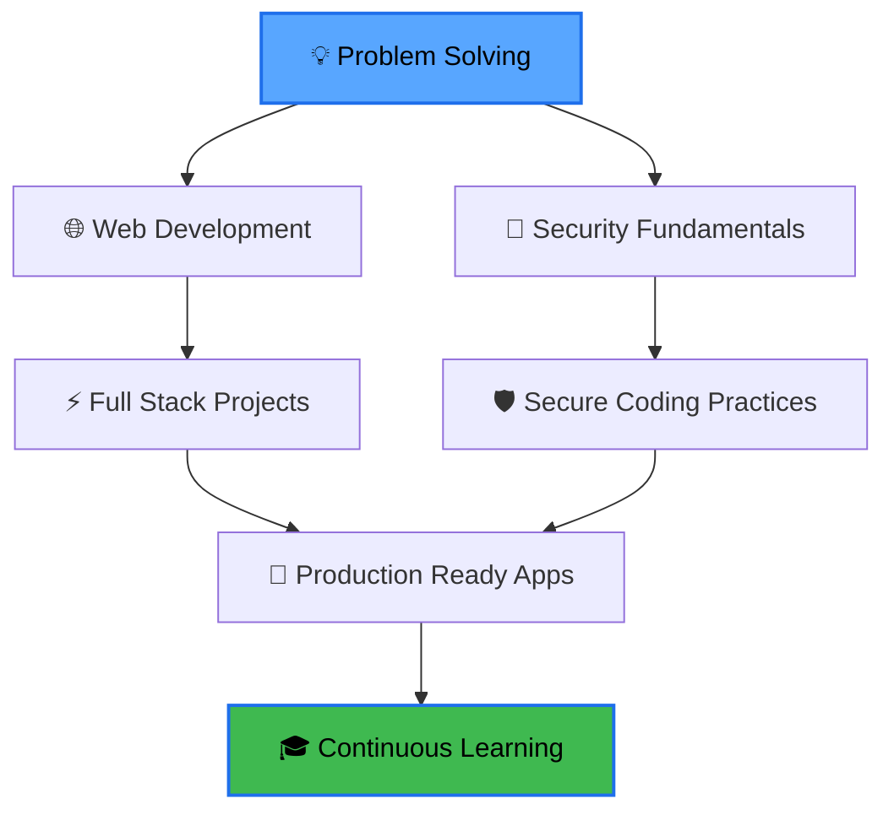

<div align="center">

<!-- Animated Banner -->


<!-- Typing Animation -->
<a href="https://git.io/typing-svg"></a>

<br/>

<!-- Badges Row -->
<p>
  
  
  
</p>

<!-- Profile Views Counter -->


<!-- Social Links -->
<p>
  <a href="https://github.com/vishalacharya09">
    
  </a>
  <a href="https://linkedin.com/in/vishalacharya09" target="_blank">
    
  </a>
  <a href="mailto:your.email@example.com">
    
  </a>
  <a href="https://twitter.com/vishalacharya09" target="_blank">
    
  </a>
</p>

</div>

---


### 👨‍💻 About Me

Hey there! I'm **Vishal Acharya**, a passionate developer who loves turning coffee into code ☕➡️💻

```javascript
const vishal = {
    pronouns: "He" | "Him",
    location: "India 🇮🇳",
    role: "Developer & Security Enthusiast",
    code: ["Python", "C++", "JavaScript", "Bash", "HTML/CSS"],
    interests: ["Web Development", "Algorithms", "Cybersecurity", "Networking"],
    currentFocus: "Building robust applications & learning security",
    funFact: "I debug code faster than I debug my life 😄",
    motto: "Write code that matters, secure what you build",
    
    challenge: "Learning something new every single day 🚀"
};
```

**🎯 What I Do:**
- 🔨 Build web applications and cool projects
- 🧩 Solve algorithmic challenges on LeetCode
- 🔐 Practice cybersecurity and network fundamentals
- 📚 Continuously learning and experimenting
- 🤝 Open to collaborations and new opportunities

<br clear="right"/>

---

### 🛠️ Technology Stack

<details open>
<summary><b>💻 Languages & Frameworks</b></summary>
<br/>


</details>

<details open>
<summary><b>🔧 Tools & Technologies</b></summary>
<br/>


</details>

<details>
<summary><b>🔐 Security & Networking</b></summary>
<br/>


</details>

<details>
<summary><b>☁️ Platforms & Systems</b></summary>
<br/>


</details>

---

### 📊 GitHub Analytics

<p align="center">
  
  
</p>

<p align="center">
  
</p>

<p align="center">
  
</p>

---

### 🏆 Achievements & Trophies

<p align="center">
  
</p>

---

### 💼 Featured Projects

<div align="center">

<table>
<tr>
<td width="50%">

<h3 align="center">Portfolio Website</h3>
<div align="center">  
<a href="https://github.com/vishalacharya09/portfolio">

</a>
<br/>
<p><b>Tech Stack:</b> HTML, CSS, JavaScript</p>
<p>Personal portfolio showcasing projects and skills</p>
</div>
</td>

<td width="50%">

<h3 align="center">LeetCode Solutions</h3>
<div align="center">  
<a href="https://github.com/vishalacharya09/Leetcode-solutions">

</a>
<br/>
<p><b>Tech Stack:</b> Python, Algorithms</p>
<p>Collection of algorithmic problem solutions</p>
</div>
</td>
</tr>
</table>

</div>

---

### 📈 Coding Activity

```text
💻 Programming Languages:

Python       ████████████░░░░░░░░░   60%
C++          ██████░░░░░░░░░░░░░░░   30%
JavaScript   ████░░░░░░░░░░░░░░░░░   20%
HTML/CSS     ███░░░░░░░░░░░░░░░░░░   15%
Bash         ██░░░░░░░░░░░░░░░░░░░   10%
```

---

### 🎯 Current Focus & Learning Path

<div align="center">



</div>

<br/>

<table align="center">
<tr>
<td align="center" width="33%">

### 🎯 Current Goals

```
✅ Master DSA
✅ Build 10+ Projects
⬜ Contribute to OSS
⬜ Learn Cloud (AWS)
⬜ Security Certifications
```

</td>
<td align="center" width="33%">

### 📚 Currently Learning

```
→ Advanced JavaScript
→ React & Node.js
→ Network Security
→ System Design
→ DevOps Basics
```

</td>
<td align="center" width="33%">

### 🎮 Interests

```
• Competitive Programming
• CTF Challenges
• Open Source
• Tech Blogging
• Automation
```

</td>
</tr>
</table>

---

### 🔥 Recent Activity

<!--START_SECTION:activity-->
<!--END_SECTION:activity-->

<div align="center">

**🔹 Latest Contributions**


</div>

---

### 📝 Random Dev Quote

<div align="center">


</div>

---

### 📊 Detailed Stats

<details>
<summary><b>📈 More GitHub Statistics</b></summary>
<br/>

<p align="center">
  
  
</p>

</details>

---

### 💡 Fun Facts About Me

<div align="center">

| 🎭 Category | 💬 Details |
|:---:|:---|
| 🎵 **Music While Coding** | Lo-fi beats & instrumentals |
| ☕ **Fuel** | Coffee (lots of it!) |
| 🌙 **Peak Productivity** | Late night coding sessions |
| 🐛 **Debugging Style** | Print statements > Debugger (sometimes 😅) |
| 🎮 **Favorite IDE** | VS Code with too many extensions |
| 📖 **Currently Reading** | Clean Code by Robert C. Martin |
| 🚀 **Dream Project** | Build a SaaS that helps developers |

</div>

---

### 🤝 Let's Connect & Collaborate!

<div align="center">

I'm always excited to connect with fellow developers, work on interesting projects, or just chat about tech! Whether you have a project idea, need help with something, or want to collaborate, feel free to reach out.

<br/>

<a href="https://linkedin.com/in/vishalacharya09">
  
</a>
<a href="mailto:your.email@example.com">
  
</a>
<a href="https://twitter.com/vishalacharya09">
  
</a>
<a href="https://github.com/vishalacharya09">
  
</a>

<br/><br/>

### 💰 Support My Work

<a href="https://www.buymeacoffee.com/vishalacharya09">
  
</a>
<a href="https://ko-fi.com/vishalacharya09">
  
</a>

</div>

---

### 📌 Pinned Repositories

<div align="center">

[](https://github.com/vishalacharya09/portfolio)
[](https://github.com/vishalacharya09/Leetcode-solutions)

</div>

---

### 🎨 Coding Philosophy

<div align="center">

> **"Code is like humor. When you have to explain it, it's bad."** – Cory House

<br/>

**My Approach:**
- 🎯 Write clean, readable, and maintainable code
- 🔒 Security-first mindset in everything I build
- 📖 Document code like I'm explaining to my future self
- 🧪 Test thoroughly, deploy confidently
- 🔄 Refactor regularly, improve constantly
- 🤝 Collaborate openly, learn from everyone

</div>

---

### 📚 Resources I Recommend

<details>
<summary><b>🔖 Learning Resources</b></summary>
<br/>

**📺 Channels & Platforms:**
- [freeCodeCamp](https://www.freecodecamp.org/) - Web Development
- [LeetCode](https://leetcode.com/) - Algorithmic Practice
- [HackerRank](https://www.hackerrank.com/) - Coding Challenges
- [TryHackMe](https://tryhackme.com/) - Cybersecurity Learning
- [Codecademy](https://www.codecademy.com/) - Interactive Learning

**📖 Books:**
- Clean Code - Robert C. Martin
- The Pragmatic Programmer - Andy Hunt & Dave Thomas
- Cracking the Coding Interview - Gayle McDowell
- Introduction to Algorithms - CLRS

**🎓 Skills:**
- Problem Solving & Algorithms
- Web Development (Front-end & Back-end)
- Database Design & Management
- Network Security Fundamentals
- Version Control & Collaboration

</details>

---

### 🎯 2025 Roadmap

<div align="center">

| Quarter | Goals | Status |
|:---:|:---|:---:|
| **Q1** | Complete 100 LeetCode problems | 🟡 In Progress |
| **Q1** | Build 3 full-stack projects | 🟡 In Progress |
| **Q2** | Learn React & Node.js ecosystem | ⬜ Planned |
| **Q2** | Contribute to 5 open-source projects | ⬜ Planned |
| **Q3** | Complete AWS certification | ⬜ Planned |
| **Q3** | Build a production-ready SaaS | ⬜ Planned |
| **Q4** | Security certification (CEH/OSCP) | ⬜ Planned |
| **Q4** | Launch personal tech blog | ⬜ Planned |

</div>

---

<div align="center">

### 🌟 Remember

**"The best error message is the one that never shows up."** - Thomas Fuchs

<br/>

### Thanks for visiting! Show some ❤️ by starring repositories you find interesting!

<br/>


<br/>


**⭐ From [vishalacharya09](https://github.com/vishalacharya09)**

</div>
