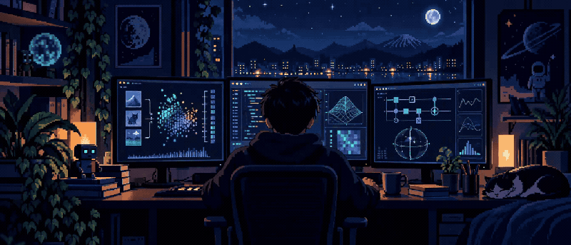
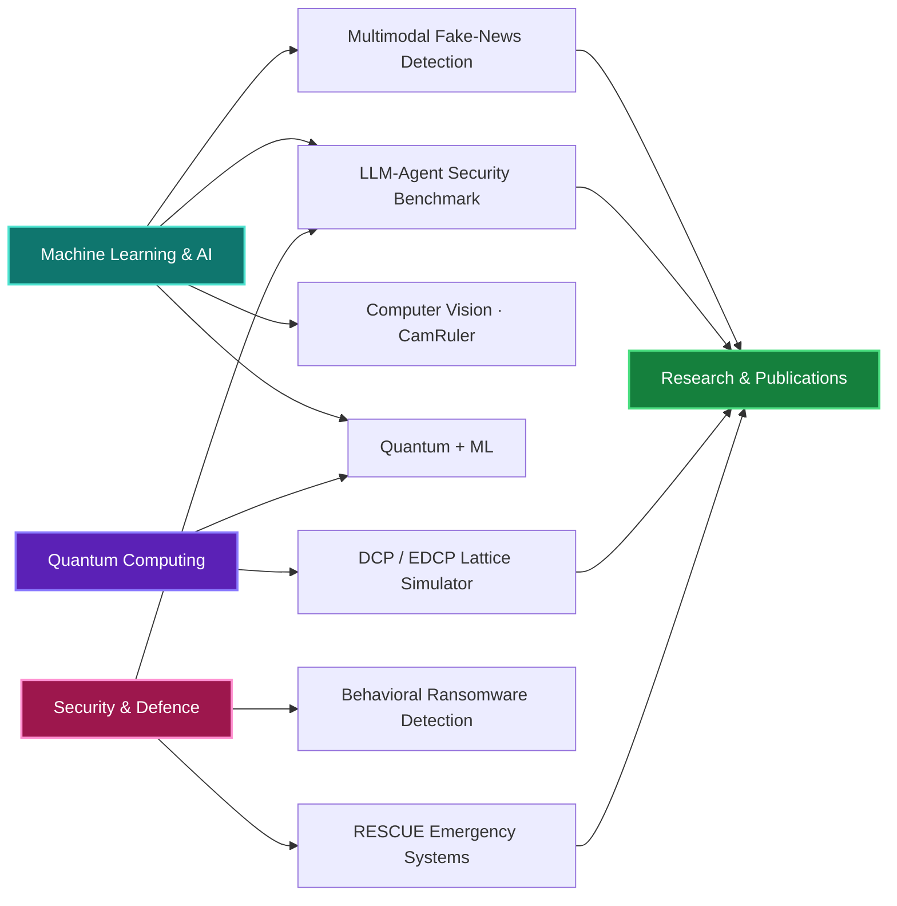

<div align="center">



# Vishal Acharya

<a href="https://git.io/typing-svg"></a>


<br/><br/>

<a href="https://github.com/vishalacharya09"></a>
<a href="https://linkedin.com/in/vishal-acharya"></a>
<a href="mailto:vishalacharya2108@gmail.com"></a>


</div>

<p align="center"></p>

## 🧠 About Me

Third-year B.Tech CSE student at **VJTI Mumbai**, with a minor in **Defence Technology**. My main focus is **machine learning and AI**—especially multimodal models, NLP, and LLM agents. I also explore **quantum computing and security**, and I’m aiming for research internships, publications, and graduate study.

```python
class Vishal:
    focus = ["Machine Learning", "Deep Learning", "Multimodal AI", "NLP / LLM agents"]
    also = ["Quantum computing", "Post-quantum security", "Defence tech"]
    stack = ["PyTorch", "CLIP", "OpenCV", "FastAPI", "Qiskit"]
    training = ["prompt-injection benchmark", "lattice-attack simulator"]
    seeking = "ML / AI research internships & collaborations"
    fuel = ["lo-fi", "coffee", "loss.backward()"]
```

<p align="center"></p>

## 🏋️ Currently Training

| | Project / Learning track | Status |
|:--:|:--|:--|
| 🛡️ | **Prompt-injection benchmark** for security-investigation LLM agents (English / Hindi / Marathi) | Planned: design and roadmap |
| 🧠 | **NVIDIA DLI: Fundamentals of Deep Learning** (transfer learning, augmentation) | In progress |
| 🧮 | **DCP / EDCP lattice-attack simulator**, becoming an interactive web app | Core engine built; web version next |
| 🚨 | **RESCUE**: admission control for emergency communication gateways | Research in progress |

<p align="center"></p>

## 🤖 Machine Learning & AI Projects

<details open>
<summary><b>📰 Cross-Modal Fake News Thumbnail Detection</b> · PyTorch · CLIP · FastAPI · Streamlit</summary>

Flags misleading thumbnail/headline pairs by modelling image-text consistency.

- CLIP ViT-B/32 encoders with cross-modal attention
- Monte Carlo Dropout for uncertainty-aware predictions
- FastAPI inference service with a Streamlit front end
- Team project

</details>

<details open>
<summary><b>🛡️ Prompt-Injection Benchmark for Cybersecurity Agents</b> · planned · Python · SQLite · Pydantic · Docker</summary>

An adaptive, multilingual benchmark for LLM investigation agents with provenance-aware tool authorization.

- One agent with three SOC-style tools: SIEM search, threat-intel lookup, and ticket creation (synthetic data only)
- English, Hindi, and Marathi injections; static and adaptive attackers
- Compares no defence, classifier, policy-layer, and layered defences
- Reference frameworks: AgentDojo and AgentLAB

</details>

<details>
<summary><b>👁️ CamRuler: Real-Time Object Measurement</b> · Python · OpenCV</summary>

A computer-vision pipeline that measures real-world object size from a live camera feed. Also written up as an IEEE-style review paper. Team project.

</details>

<details>
<summary><b>🦠 Behavioral Ransomware Detection</b> · Python · watchdog · psutil</summary>

Detects ransomware from behavior rather than signatures using filesystem and process monitoring, Shannon-entropy analysis of file writes, and Z-score filtering to reduce false positives. Two-person project.

</details>

<details>
<summary><b>💬 MuseBot</b> · FastAPI · React · Anthropic API</summary>

A chatbot built for my portfolio and to learn LLM application design.

</details>

<details>
<summary><b>✈️ CerebroX: AI Travel Planner</b> · Python · NLP · Pandas · Flask</summary>

An NLP intent classifier turns preferences, budget, and location into day-by-day itineraries with matched attractions and stays.

</details>

<p align="center"></p>

## ⚛️ Quantum & Systems Research

<details open>
<summary><b>🧮 DCP / EDCP Lattice-Attack Simulator</b> · Python · Qiskit · Qiskit-Aer</summary>

A simulator for the Dihedral Coset Problem and its extended variant—the quantum-sampling step behind toy lattice-attack pipelines.

- DCP state preparation and QFT-based Fourier sampling
- Truncation sweeps, sample-complexity analysis, noise, and scaling experiments
- Generic EDCP engine and a simplified modulus-halving recovery step
- **Next:** an interactive website for running and visualizing the pipeline

</details>

<details>
<summary><b>🚨 RESCUE: Admission Control for Emergency Gateways</b> · Python · PostgreSQL</summary>

Research on keeping emergency communication systems responsive under disaster surges and adaptive resource-exhaustion denial-of-service attacks.

- Lease-based admission control, owner-confirmed release, quarantine, and database fencing
- Policy ladder evaluated against formally stated hypotheses
- Primary metric: legitimate requests completed by deadline ÷ requests offered

</details>

| Project | Details |
|:--|:--|
| **⚛️ Quantum Prisoner's Dilemma** · Python · Qiskit · NumPy · Streamlit · Plotly | EWL protocol over entangled qubits. The quantum “Q” strategy moves the equilibrium from classical (1,1) to optimal (3,3). Includes a 3D payoff surface, noise simulation, and a vectorized `einsum` backend. [Repository](https://github.com/vishalacharya09/quantum-prisoners-dilemma) |
| **🔐 Quantum Secret Sharing (HBB)** · Python · Qiskit | GHZ distribution, Bell-measurement encoding, collaborative decoding, an attack simulator, and a lightweight 3-qubit bit-flip correction wrapper. [Repository](https://github.com/vishalacharya09/quantum-secret-sharing) |
| **🌌 Interactive Quantum Journey** | An educational platform built for the VJTI community. |

<p align="center"></p>

## 🛠️ Tech Stack

**AI / ML:** PyTorch · OpenCV · NumPy · Pandas  
**Concepts:** CLIP · cross-modal attention · transfer learning (VGG16) · Monte Carlo Dropout · NLP intent classification · LLM-agent security

**Languages & backend:** Python · C++ · JavaScript · SQL · FastAPI · Flask · React · Streamlit · PostgreSQL  
**Quantum:** Qiskit · QFT / Fourier sampling · Dihedral Coset Problem · HBB secret sharing · EWL game theory · GHZ states · noise and decoherence · error correction · NMR quantum processing  
**Tools:** Git · Docker · Linux · Kali Linux · VS Code · Google Cloud

## 🧭 How It All Connects



## 🔬 Research Exposure

| | Event | Highlights |
|:--:|:--|:--|
| 🏛️ | **I-HUB Quantum Technology Foundation, IISER Pune** *(Apr 2026)* | Live NMR-based quantum information processing, the “Genetic Coffee” experiment, and quantum hardware platforms. |

## 🎯 Roadmap

- [x] Multimodal ML project (CLIP + cross-modal attention)
- [x] Quantum protocol implementations
- [x] I-HUB research visit
- [ ] Publish a research paper
- [ ] Ship the DCP / EDCP web simulator
- [ ] Release the prompt-injection benchmark
- [ ] Contribute to Qiskit (open source)
- [ ] Cloud certification (AWS / GCP)

## 📊 GitHub Analytics

<p align="center">
  
  
</p>

<p align="center">
  
</p>

## 🤝 Let's Connect

Always happy to talk about ML, LLM-agent security, quantum algorithms, or research collaborations.

<div align="center">


[](https://linkedin.com/in/vishal-acharya)
[](mailto:vishalacharya2108@gmail.com)
[](https://github.com/vishalacharya09)

*“The quantum world doesn't follow your intuition, so build intuition for it.”*

<sub>Last updated October 2026</sub>

</div>
