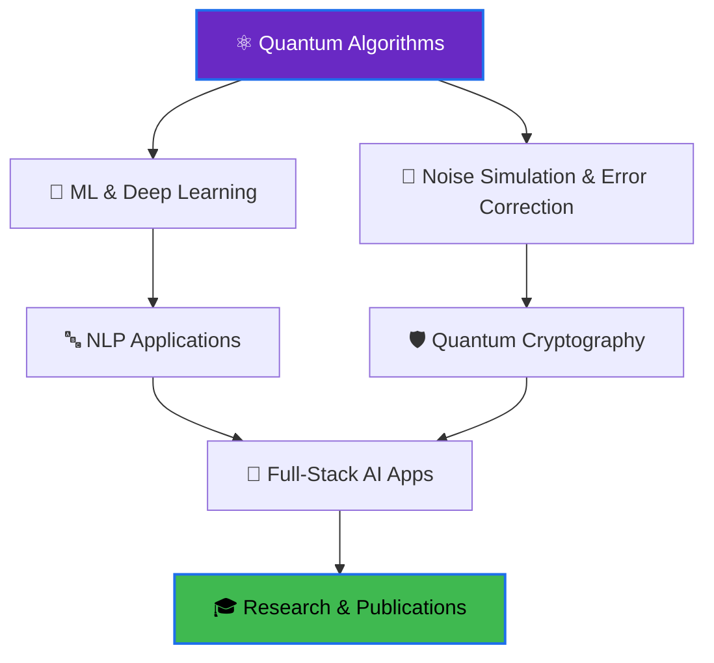

<div align="center">

<!-- Animated Banner -->


<!-- Typing Animation -->
<a href="https://git.io/typing-svg"></a>

<br/>

<p>
  
  
  
</p>


<p>
  <a href="https://github.com/vishalacharya09">
    
  </a>
  <a href="https://linkedin.com/in/vishal-acharya" target="_blank">
    
  </a>
  <a href="mailto:vishalacharya2108@gmail.com">
    
  </a>
</p>

</div>

---


### 👨‍💻 About Me

Hey! I'm **Vishal Acharya**, a third-year CSE student at **VJTI Mumbai** pursuing a Minor in **Defence Technology**.

```python
vishal = {
    "location": "Mumbai, India 🇮🇳",
    "institute": "VJTI Mumbai (2023–2027)",
    "minor": "Defence Technology",
    "interests": ["Quantum Computing", "Machine Learning",
                  "Cybersecurity", "NLP"],
    "tools": ["Qiskit", "PyTorch", "Flask", "Streamlit"],
    "languages": ["Python", "C++", "JavaScript", "Q#", "SQL"],
    "highlight": "Visited I-HUB @ IISER Pune for live NMR quantum research 🔬",
    "motto": "Build at the edge — where classical meets quantum",
}
```

**🎯 What I'm focused on:**
- ⚛️ Quantum algorithms — EWL Protocol, HBB Secret Sharing, GHZ States
- 🤖 ML & NLP — PyTorch-based models, NLP intent classifiers
- 🔐 Cybersecurity & Network Security fundamentals
- 🛡️ Defence Technology (minor coursework + research)
- 📊 Interactive data visualizations with Streamlit & Plotly

<br clear="right"/>

---

### 🛠️ Technology Stack

<details open>
<summary><b>💻 Languages</b></summary>
<br/>


</details>

<details open>
<summary><b>⚛️ Quantum Computing</b></summary>
<br/>


**Concepts:** QSS (HBB Protocol) • EWL Protocol • GHZ States • NMR Quantum Processing • Quantum Error Correction • Depolarizing Noise Simulation • Bell Measurements • SU(2) Unitary Strategies

</details>

<details open>
<summary><b>🤖 AI & Machine Learning</b></summary>
<br/>


</details>

<details>
<summary><b>🔧 Developer Tools & Platforms</b></summary>
<br/>


</details>

---

### 📊 GitHub Analytics

<p align="center">
  
  
</p>

<p align="center">
  
</p>

---

### 💼 Featured Projects

<div align="center">
<table>
<tr>
<td width="50%">

<h3 align="center">⚛️ Quantum Prisoner's Dilemma</h3>
<div align="center">
<a href="https://github.com/vishalacharya09">

</a>
<br/>
<p><b>Stack:</b> Python · Qiskit · NumPy · Streamlit · Plotly</p>
<p>EWL Protocol implementation over entangled qubits. Quantum "Q" strategy shifts Nash Equilibrium from (1,1) → (3,3). Features 3D payoff surface, Cyberpunk terminal mode, and depolarizing noise simulation.</p>
</div>
</td>

<td width="50%">

<h3 align="center">🔐 Quantum Secret Sharing</h3>
<div align="center">
<a href="https://github.com/vishalacharya09">

</a>
<br/>
<p><b>Stack:</b> Python · Qiskit</p>
<p>Full HBB protocol: GHZ state prep, Bell measurement encoding, three-party decoding. Includes attack simulator (Intercept-and-Resend, Entangle-and-Measure) and 3-qubit bit-flip correction.</p>
</div>
</td>
</tr>

<tr>
<td width="50%">

<h3 align="center">✈️ AI Travel Planner – CerebroX</h3>
<div align="center">
<br/>
<p><b>Stack:</b> Python · NLP · Pandas · Flask</p>
<p>Flask app that takes travel preferences, budget, and location through an NLP intent classifier to generate day-by-day itineraries with matched attractions and stays.</p>
</div>
</td>

<td width="50%">

<h3 align="center">📌 More Coming Soon...</h3>
<div align="center">
<br/>
<p>Always building something new at the intersection of quantum computing, AI, and security.</p>
<p><a href="https://github.com/vishalacharya09">→ View all repositories</a></p>
</div>
</td>
</tr>
</table>
</div>

---

### 🔬 Research & Industrial Exposure

<div align="center">

| 📍 | Event | Details |
|:---:|:---|:---|
| 🏛️ | **I-HUB Quantum Technology Foundation, IISER Pune** *(April 2026)* | Observed live NMR-based quantum information processing, the Genetic Coffee experiment, and quantum hardware setups. Saw real qubit control and decoherence play out — grounding theory in hardware reality. |

*Organized by Dept. of Computer Engineering & IT, VJTI Mumbai*

</div>

---

### 🎯 Current Focus & Learning

<div align="center">



</div>

<table align="center">
<tr>
<td align="center" width="33%">

### 🎯 Goals

```
✅ Quantum Protocol Impl.
✅ I-HUB Research Visit
⬜ Research Paper
⬜ AWS / GCP Cert.
⬜ Contribute to Qiskit OSS
```

</td>
<td align="center" width="33%">

### 📚 Currently Exploring

```
→ Quantum Game Theory
→ PyTorch (Deep Learning)
→ Defence Tech (Minor)
→ Quantum Error Correction
→ Advanced NLP
```

</td>
<td align="center" width="33%">

### 🎮 Interests

```
• Quantum Computing
• Cybersecurity / CTFs
• Competitive Programming
• Open Source
• Music 🎵
```

</td>
</tr>
</table>

---

### 📈 Coding Activity

```text
💻 Languages I Use:

Python       ██████████████░░░░░░░   65%
C++          ████████░░░░░░░░░░░░░   35%
JavaScript   █████░░░░░░░░░░░░░░░░   20%
Q# / Qiskit  ████░░░░░░░░░░░░░░░░░   15%
SQL          ███░░░░░░░░░░░░░░░░░░   10%
```

---

### 🤝 Let's Connect!

<div align="center">

<a href="https://linkedin.com/in/vishal-acharya">
  
</a>
<a href="mailto:vishalacharya2108@gmail.com">
  
</a>
<a href="https://github.com/vishalacharya09">
  
</a>

</div>

---

<div align="center">

**"The quantum world doesn't follow your intuition — so build intuition for the quantum world."**

<br/>


**⭐ From [vishalacharya09](https://github.com/vishalacharya09)**

</div>
