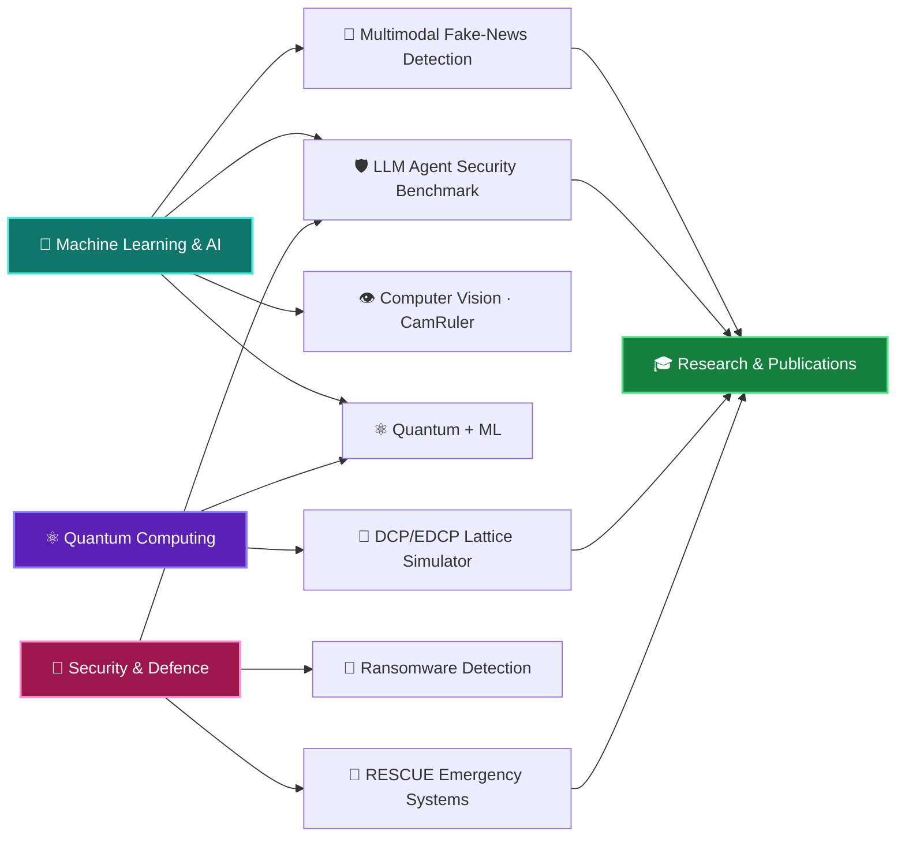

<div align="center">


<h1>Vishal Acharya</h1>

<a href="https://git.io/typing-svg"></a>

<br/>


<br/><br/>

<a href="https://github.com/vishalacharya09"></a>
<a href="https://linkedin.com/in/vishal-acharya"></a>
<a href="mailto:vishalacharya2108@gmail.com"></a>


</div>


## 🧠 About Me

Third-year B.Tech CSE student at **VJTI Mumbai** (Minor in **Defence Technology**). My main focus is **machine learning and AI**: multimodal models, NLP and LLM agents. I pair it with **quantum computing and security**, and I'm aiming for ML research internships, publications and grad school.

```python
class Vishal:
    focus      = ["Machine Learning", "Deep Learning", "Multimodal AI", "NLP / LLM agents"]
    also       = ["Quantum computing", "Post-quantum security", "Defence tech"]
    stack      = ["PyTorch", "CLIP", "OpenCV", "FastAPI", "Qiskit"]
    training   = ["prompt-injection benchmark", "lattice-attack simulator"]
    seeking    = "ML / AI research internships & collaborations"
    fuel       = ["lo-fi", "coffee", "loss.backward()"]
```


## 🏋️ Currently Training

| | Run | Status |
|:-:|:--|:--|
| 🛡️ | **Prompt-injection benchmark** for security-investigation LLM agents (English / Hindi / Marathi) | Planned: design & roadmap |
| 🧠 | **NVIDIA DLI: Fundamentals of Deep Learning** (transfer learning, augmentation) | In progress |
| 🧮 | **DCP / EDCP lattice-attack simulator**, now becoming an interactive web app | Core engine built, web version next |
| 🚨 | **RESCUE**: admission control for emergency communication gateways | Research in progress |


## 🤖 Machine Learning & AI Projects

<details open>
<summary><b>📰 Cross-Modal Fake News Thumbnail Detection</b> · <i>PyTorch · CLIP · FastAPI · Streamlit</i></summary>
<br/>

Flags misleading thumbnail/headline pairs by modelling image-text consistency.

- **CLIP ViT-B/32** encoders with **cross-modal attention**
- **Monte Carlo Dropout** for uncertainty-aware predictions
- FastAPI inference service with a Streamlit front end
- Team project

</details>

<details open>
<summary><b>🛡️ Prompt-Injection Benchmark for Cybersecurity Agents</b> · <i>planned · Python · SQLite · Pydantic · Docker</i></summary>
<br/>

An adaptive, multilingual benchmark for LLM investigation agents with provenance-aware tool authorization.

- One agent with three SOC-style tools: SIEM search, threat-intel lookup, ticket creation (synthetic data only)
- English, Hindi and Marathi injections; static vs adaptive attackers
- Defences compared: none / classifier / policy layer / layered
- Reference frameworks: AgentDojo, AgentLAB

</details>

<details>
<summary><b>👁️ CamRuler: Real-Time Object Measurement</b> · <i>Python · OpenCV</i></summary>
<br/>

Computer-vision pipeline that measures real-world object size from a live camera feed. Also written up as an IEEE-style review paper. Team project.

</details>

<details>
<summary><b>🦠 Behavioral Ransomware Detection</b> · <i>Python · watchdog · psutil</i></summary>
<br/>

Detects ransomware from behaviour instead of signatures: filesystem and process monitoring, **Shannon-entropy** analysis of file writes, and **Z-score** filtering to keep false positives down. Two-person project.

</details>

<details>
<summary><b>💬 MuseBot</b> · <i>FastAPI · React · Anthropic API</i></summary>
<br/>

A chatbot I built for my portfolio and to learn LLM application design.

</details>

<details>
<summary><b>✈️ CerebroX: AI Travel Planner</b> · <i>Python · NLP · Pandas · Flask</i></summary>
<br/>

An NLP intent classifier turns preferences, budget and location into day-by-day itineraries with matched attractions and stays.

</details>


## ⚛️ Quantum & Systems Research

<details open>
<summary><b>🧮 DCP / EDCP Lattice-Attack Simulator</b> · <i>Python · Qiskit · Qiskit-Aer</i></summary>
<br/>

Simulator for the Dihedral Coset Problem and its extended variant, the quantum-sampling step behind toy lattice-attack pipelines.

- DCP state preparation and QFT-based Fourier sampling
- Truncation sweeps, sample-complexity analysis, noise and scaling experiments
- Generic EDCP engine and a simplified modulus-halving recovery step
- **Next:** an interactive website for running and visualising the pipeline

</details>

<details>
<summary><b>🚨 RESCUE: Admission Control for Emergency Gateways</b> · <i>Python · PostgreSQL</i></summary>
<br/>

Research on keeping emergency communication systems responsive under disaster surges and adaptive resource-exhaustion DoS.

- Lease-based admission control, owner-confirmed release, quarantine and database fencing
- Policy ladder evaluated against formally stated hypotheses
- Primary metric: legitimate requests completed by deadline ÷ requests offered

</details>

<table>
<tr>
<td width="50%" valign="top">

**⚛️ Quantum Prisoner's Dilemma** <br/>
<sub>Python · Qiskit · NumPy · Streamlit · Plotly</sub>

EWL protocol over entangled qubits. The quantum "Q" strategy moves the equilibrium from classical (1,1) to optimal (3,3). Includes a 3D payoff surface, noise simulation and a vectorised `einsum` backend.

[](https://github.com/vishalacharya09/quantum-prisoners-dilemma)

</td>
<td width="50%" valign="top">

**🔐 Quantum Secret Sharing (HBB)** <br/>
<sub>Python · Qiskit</sub>

GHZ distribution, Bell-measurement encoding and collaborative decoding, with an attack simulator and a lightweight 3-qubit bit-flip correction wrapper.

[](https://github.com/vishalacharya09/quantum-secret-sharing)

</td>
</tr>
<tr>
<td colspan="2" valign="top">

**🌌 Interactive Quantum Journey** · <sub>educational platform built for the VJTI community</sub>

</td>
</tr>
</table>


## 🛠️ Tech Stack

<details open>
<summary><b>🤖 AI / ML</b></summary>
<br/>


**Concepts:** CLIP · cross-modal attention · transfer learning (VGG16) · Monte Carlo Dropout · NLP intent classification · LLM agent security

</details>

<details open>
<summary><b>💻 Languages & Backend</b></summary>
<br/>


</details>

<details>
<summary><b>⚛️ Quantum</b></summary>
<br/>


**Concepts:** QFT / Fourier sampling · Dihedral Coset Problem · HBB secret sharing · EWL game theory · GHZ states · noise & decoherence · error correction · NMR quantum processing

</details>

<details>
<summary><b>🔧 Tools</b></summary>
<br/>


</details>


## 🧭 How It All Connects



## 🔬 Research Exposure

| | Event | Highlights |
|:-:|:--|:--|
| 🏛️ | **I-HUB Quantum Technology Foundation, IISER Pune** *(Apr 2026)* | Live NMR-based quantum information processing, the "Genetic Coffee" experiment and quantum hardware platforms. |

## 🎯 Roadmap

- [x] Multimodal ML project (CLIP + cross-modal attention)
- [x] Quantum protocol implementations
- [x] I-HUB research visit
- [ ] Publish a research paper
- [ ] Ship the DCP/EDCP web simulator
- [ ] Release the prompt-injection benchmark
- [ ] Contribute to Qiskit (open source)
- [ ] Cloud certification (AWS / GCP)


## 📊 GitHub Analytics

<p align="center">
  
  
</p>

<p align="center">
  
</p>


<div align="center">

## 🤝 Let's Connect

Always happy to talk ML, LLM-agent security, quantum algorithms, or research collaborations.

<a href="https://linkedin.com/in/vishal-acharya"></a>
<a href="mailto:vishalacharya2108@gmail.com"></a>
<a href="https://github.com/vishalacharya09"></a>

<br/><br/>

*"The quantum world doesn't follow your intuition, so build intuition for it."*


<sub>Last updated October 2026</sub>

</div>
