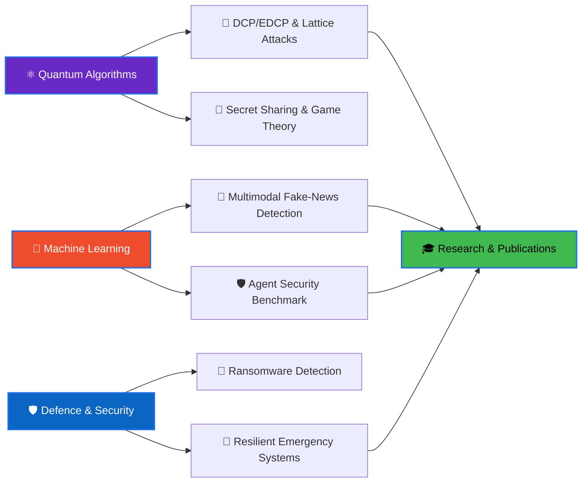

<div align="center">


<a href="https://git.io/typing-svg"></a>

<br/>


<br/><br/>

<a href="https://github.com/vishalacharya09"></a>
<a href="https://linkedin.com/in/vishal-acharya"></a>
<a href="mailto:vishalacharya2108@gmail.com"></a>


</div>

---

## 👨‍💻 About Me

I'm **Vishal Acharya**, a third-year B.Tech CSE student at **VJTI Mumbai** with a **Minor in Defence Technology**. I build things where **quantum computing, machine learning and security** meet, and I'm aiming for ML/security research internships, publications and graduate school.

```python
vishal = {
    "institute": "VJTI Mumbai (B.Tech CSE, Minor in Defence Technology)",
    "location": "Mumbai, India 🇮🇳",
    "research_interests": ["Quantum algorithms", "Post-quantum cryptanalysis",
                           "Multimodal ML", "Agent & systems security"],
    "currently_building": ["DCP/EDCP lattice-attack simulator",
                           "RESCUE: admission control for emergency gateways"],
    "looking_for": "ML / security research internships & collaborations",
    "motto": "Build at the edge, where classical meets quantum",
}
```

---

## 🔭 What I'm Working On Right Now

| | Project | Status |
|:-:|:--|:--|
| 🔬 | **DCP/EDCP Lattice Attack Simulator** (final-year project) | Core engine built; turning it into an interactive web simulator |
| 🚨 | **RESCUE**: completion-backed admission control for emergency communication gateways | Research in progress: simulation harness + PostgreSQL fencing validator |
| 🛡️ | **Prompt-injection benchmark for security-investigation agents** | Planned: adaptive, multilingual (English/Hindi/Marathi), tool-authorization focus |
| 🧠 | **NVIDIA DLI: Fundamentals of Deep Learning** | Transfer learning (VGG16), data augmentation, PyTorch |

---

## 💼 Featured Projects

### 🔬 Research

<details open>
<summary><b>🧮 DCP / EDCP Lattice Attack Simulator</b> — <i>Python · Qiskit · Qiskit-Aer</i></summary>
<br/>

Simulator for the **Dihedral Coset Problem (DCP)** and its extended variant (EDCP), the quantum-sampling step behind toy lattice-attack pipelines.

- DCP state preparation and QFT-based Fourier sampling
- Truncation sweeps, sample-complexity analysis, and noise/scaling experiments
- Generic EDCP engine and a simplified modulus-halving recovery step
- Automated test suite covering each phase
- **Next:** an interactive website to run and visualise the attack pipeline

</details>

<details open>
<summary><b>🚨 RESCUE: Admission Control for Emergency Communication Gateways</b> — <i>Python · PostgreSQL</i></summary>
<br/>

Research on keeping emergency communication systems (floods, earthquakes) responsive under disaster surges *and* adaptive resource-exhaustion DoS.

- Lease-based admission control, owner-confirmed release, executor quarantine and database fencing
- Policy ladder compared across multiple workloads and enforcement levels, with formally stated hypotheses
- Primary metric: legitimate requests completed by their deadline, divided by requests offered
- Simulation harness plus a PostgreSQL logical-decoding fencing checker

</details>

<details>
<summary><b>🛡️ Adaptive Multilingual Prompt-Injection Benchmark</b> — <i>planned · Python · SQLite · Pydantic · Docker</i></summary>
<br/>

A benchmark for **cybersecurity investigation agents** with provenance-aware tool authorization.

- One agent, three SOC-style tools (SIEM search, threat-intel lookup, ticket creation), synthetic data only
- English, Hindi and Marathi injections; static vs adaptive attackers
- Defences compared: none / classifier / policy layer / layered
- Reference frameworks: AgentDojo, AgentLAB

</details>

### 🤖 Machine Learning & Security

<details>
<summary><b>📰 Cross-Modal Fake News Thumbnail Detection</b> — <i>PyTorch · CLIP · Streamlit · FastAPI</i></summary>
<br/>

Detects misleading thumbnail/headline pairs by modelling image-text consistency.

- **CLIP ViT-B/32** encoders with **cross-modal attention**
- **Monte Carlo Dropout** for uncertainty estimates
- Streamlit front end backed by a FastAPI inference service
- Team project

</details>

<details>
<summary><b>🦠 Behavioral Ransomware Detection</b> — <i>Python · watchdog · psutil</i></summary>
<br/>

Detects ransomware by *what it does* rather than by signatures.

- Filesystem monitoring with `watchdog`, process telemetry with `psutil`
- **Shannon-entropy** analysis of written files plus **Z-score** filtering to cut false positives
- Two-person project

</details>

<details>
<summary><b>📏 CamRuler: Real-Time Object Measurement</b> — <i>Python · OpenCV</i></summary>
<br/>

Measures real-world object dimensions from a live camera feed.

- OpenCV computer-vision pipeline
- Written up as an IEEE-style review paper
- Team project

</details>

### ⚛️ Quantum Computing

<table>
<tr>
<td width="50%" valign="top">

**⚛️ Quantum Prisoner's Dilemma** <br/>
<sub>Python · Qiskit · NumPy · Streamlit · Plotly</sub>

EWL protocol over entangled qubits. The quantum "Q" strategy moves the equilibrium from the classical (1,1) to the optimal (3,3).

- 3D interactive payoff surface
- Depolarizing-noise and decoherence simulation
- Vectorised NumPy `einsum` backend
- Cyberpunk terminal UI and CLI mode

[](https://github.com/vishalacharya09/quantum-prisoners-dilemma)

</td>
<td width="50%" valign="top">

**🔐 Quantum Secret Sharing (HBB)** <br/>
<sub>Python · Qiskit</sub>

Full Hillery-Bužek-Berthiaume protocol.

- GHZ state distribution, Bell-measurement encoding, collaborative decoding
- Attack simulator: Intercept-and-Resend, Entangle-and-Measure
- Lightweight 3-qubit bit-flip error-correction wrapper

[](https://github.com/vishalacharya09/quantum-secret-sharing)

</td>
</tr>
<tr>
<td colspan="2" valign="top">

**🌌 Interactive Quantum Journey** <br/>
<sub>Educational platform built for the VJTI community</sub>

</td>
</tr>
</table>

### 🌐 Full-Stack & AI Apps

<table>
<tr>
<td width="50%" valign="top">

**💬 MuseBot** <br/>
<sub>FastAPI · React · Anthropic API</sub>

A chatbot built for my portfolio and for learning LLM application design.

</td>
<td width="50%" valign="top">

**✈️ CerebroX: AI Travel Planner** <br/>
<sub>Python · NLP · Pandas · Flask</sub>

An NLP intent classifier turns preferences, budget and location into day-by-day itineraries.

</td>
</tr>
</table>

---

## 🛠️ Tech Stack

<details open>
<summary><b>💻 Languages</b></summary>
<br/>


</details>

<details open>
<summary><b>⚛️ Quantum</b></summary>
<br/>


**Concepts:** HBB Secret Sharing · EWL Game Theory · GHZ States · Fourier Sampling / QFT · Dihedral Coset Problem · Noise & Decoherence · Error Correction · NMR Quantum Processing

</details>

<details open>
<summary><b>🤖 AI / ML</b></summary>
<br/>


**Concepts:** CLIP · Cross-modal attention · Transfer learning (VGG16) · MC Dropout · NLP intent classification

</details>

<details>
<summary><b>🌐 Backend, Apps & Data</b></summary>
<br/>


</details>

<details>
<summary><b>🔧 Tools & Platforms</b></summary>
<br/>


</details>

---

## 🧭 How My Work Connects



---

## 🔬 Research Exposure

| | Event | Highlights |
|:-:|:--|:--|
| 🏛️ | **I-HUB Quantum Technology Foundation, IISER Pune** *(Apr 2026)* | Live **NMR-based quantum information processing**, the "Genetic Coffee" experiment and quantum hardware platforms, seeing qubit control and decoherence outside of simulation. |

---

## 🎯 Goals & Learning

<table align="center">
<tr>
<td valign="top" width="33%">

### 🎯 Goals

- [x] Quantum protocol implementations
- [x] I-HUB research visit
- [x] Multimodal ML project (CLIP)
- [ ] Publish a research paper
- [ ] Contribute to Qiskit (open source)
- [ ] Cloud certification (AWS / GCP)

</td>
<td valign="top" width="33%">

### 📚 Currently Learning

- Post-quantum cryptanalysis
- Deep learning with PyTorch (NVIDIA DLI)
- Agent security & prompt injection
- Quantum error correction
- Defence technology (minor)

</td>
<td valign="top" width="33%">

### 🎮 Interests

- Quantum computing
- Cybersecurity / CTFs
- Competitive programming
- Open source
- Music 🎵

</td>
</tr>
</table>

---

## 📊 GitHub Analytics

<p align="center">
  
  
</p>

<p align="center">
  
</p>

<p align="center">
  
</p>

---

## 🤝 Let's Connect

I'm happy to talk about quantum algorithms, post-quantum security, ML research, or collaborations and internships.

<div align="center">

<a href="https://linkedin.com/in/vishal-acharya"></a>
<a href="mailto:vishalacharya2108@gmail.com"></a>
<a href="https://github.com/vishalacharya09"></a>

<br/><br/>

**"The quantum world doesn't follow your intuition, so build intuition for the quantum world."**


</div>
